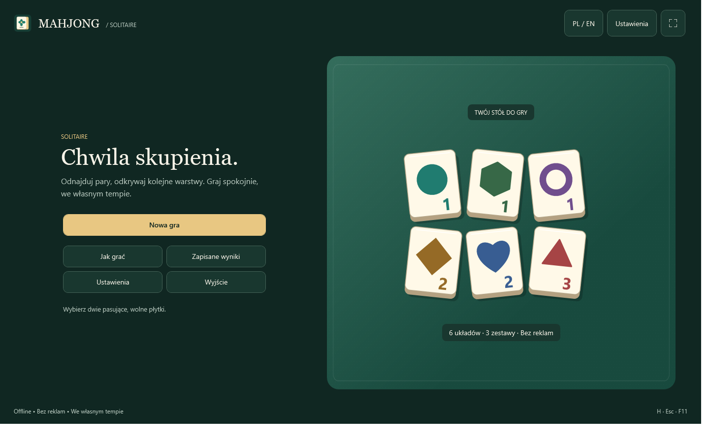
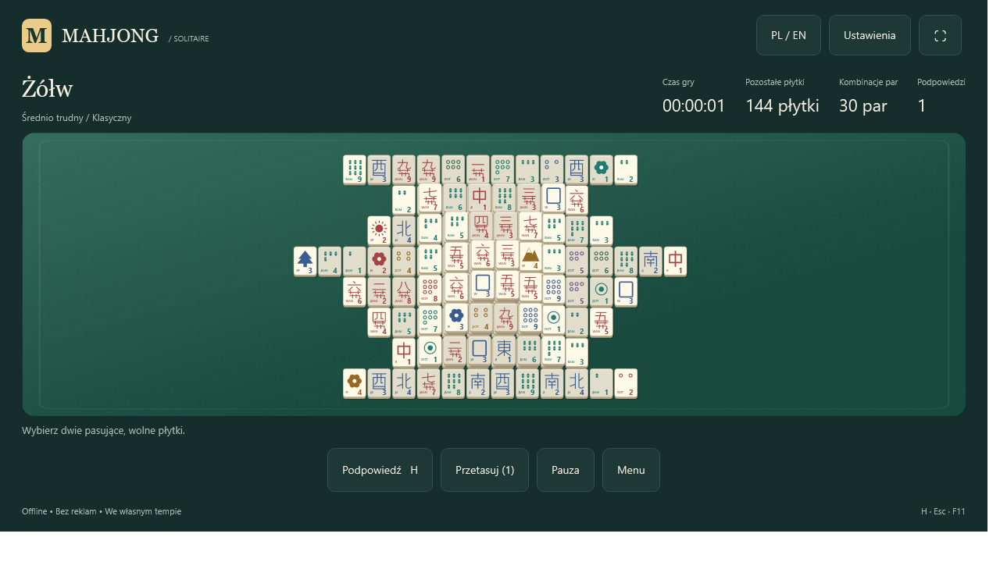
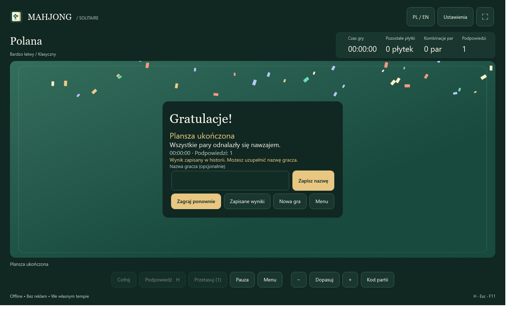

# Mahjong Solitaire — Windows

Spokojna, jednoosobowa gra offline dla Windows x64. C# / WPF / .NET 10. Bez reklam, serwera i dodatkowych pakietów NuGet.

## Pobierz grę

**[Instalator Windows x64 — Setup.exe](https://github.com/zetmar-collab/Mahjong/releases/download/v1.2.2/Mahjong-Solitaire-1.2.2-Setup-x64.exe)** · **[Wersja przenośna ZIP](https://github.com/zetmar-collab/Mahjong/releases/download/v1.2.2/Mahjong-win-x64.zip)** · **[Wszystkie wydania](https://github.com/zetmar-collab/Mahjong/releases)**

Instalator zawiera wszystkie zasoby oraz .NET. Działa offline i nie wymaga administratora. Po instalacji uruchom grę z menu Start. Wersję przenośną rozpakuj w całości i uruchom Mahjong.exe. Wydanie nie jest podpisane cyfrowo. Testy wykonano na Windows 11 x64; osobnego uruchomienia na Windows 10 nie weryfikowano.

**English:** Download the [Windows installer](https://github.com/zetmar-collab/Mahjong/releases/download/v1.2.2/Mahjong-Solitaire-1.2.2-Setup-x64.exe) or the [portable ZIP](https://github.com/zetmar-collab/Mahjong/releases/download/v1.2.2/Mahjong-win-x64.zip). The runtime is bundled and the game works offline. Use PL / EN at the top to switch languages. No administrator account is required. This release is unsigned and was tested on Windows 11 x64.

## Wersja 1.2.2 — poprawka ładowania planszy

Usunięto błąd, przez który po rozpoczęciu gry pozostawał napis „Ładowanie nowej planszy…” i nakładka blokowała kliknięcia. Testy potwierdzają znikanie nakładki i obsługę płytek we wszystkich sześciu układach, po ponownej grze, wyzwaniu dnia, wczytaniu kodu i przetasowaniu. Weryfikacja: **561 kontroli WPF i 31 zestawów silnika**, bez błędów. [Raport](docs/releases/v1.2.2-loading.md).

## Wersja 1.2.1 — poprawiony wygląd

Nowe menu, spójne kontrolki wszystkich motywów, karty ustawień, opisane filtry, wyraźne zaznaczenia i przyciski nowej gry zawsze widoczne nad stopką. Zachowano zasady i zapis. Weryfikacja: **521 kontroli WPF** oraz **31 zestawów silnika**. Szczegóły: [raport UI](docs/releases/v1.2.1-ui.md).

Aktualne publiczne wydanie: **[1.2.2](https://github.com/zetmar-collab/Mahjong/releases/tag/v1.2.2)**. Instalator zawiera grę i środowisko .NET; ZIP jest wersją przenośną.

## Wersja 1.2.0 — poprawki i rozwój

Wersja 1.2 wprowadziła poniższe poprawki i funkcje. Wszystkie są zawarte w aktualnym wydaniu 1.2.1.

- **Cofnij / Ctrl+Z:** przywraca ostatnią parę podczas aktywnej gry. Czas, podpowiedzi i liczba cofnięć zostają zachowane. Udane przetasowanie usuwa wcześniejszą historię cofania. Po zwycięstwie cofanie jest wyłączone.
- **Automatyczny wynik:** zwycięstwo od razu trafia do historii z chwilą ukończenia. Opcjonalną nazwę można uzupełnić raz na ekranie zwycięstwa, również po ponownym otwarciu gry. Starsze ukończone zapisy bez daty używają chwili pierwszego zapisu wyniku jako wartości zastępczej.
- **Historia i rekordy:** filtry układu, zestawu, gry z pomocą/bez pomocy i wyzwań; sortowanie według czasu lub daty. Rekord dotyczy tego samego układu, zestawu i kategorii pomocy. Podpowiedź, przetasowanie i cofnięcie oznaczają pomoc.
- **Powiększanie:** przyciski −, Dopasuj, + ustawiają 100–300% dopasowanego rozmiaru. Powiększoną planszę przewija się paskami; klawiatura nadal wybiera płytki.
- **Samouczek:** Jak grać → Samouczek. Trzy osobne ćwiczenia boków, warstw oraz kwiatów i pór roku nie zmieniają zapisu partii.
- **Wyzwanie dnia:** na ekranie nowej gry. Stały Żółw / Klasyczny, wspólny rozkład dla lokalnej daty kalendarzowej i algorytmu Daily v1. Wersja generatora używa jawnego PRNG i limitu węzłów bez zależnego od zegara wariantu zapasowego. Nie ma rankingu sieciowego.
- **Kod partii:** przycisk na planszy pokazuje kod MJ1 początkowego rozkładu. Skopiuj go i wklej na ekranie nowej gry. Kod zawiera symbole i rozwiązanie kontrolne, bez nazwy i postępu; dlatego jest dłuższy od samego seeda i działa niezależnie od późniejszych zmian generatora. Rozpoczęcie z kodu tworzy osobną partię; nie przypisuje jej do wyników wyzwania dnia.
- **Kopie danych:** w ustawieniach eksport/import pliku `.mahjongbackup` (ZIP z manifestem SHA-256). Obejmuje game.json, settings.json, results.json i background.png, jeśli istnieją. Import dopuszcza wyłącznie te nazwy, sprawdza zawartość przed zastąpieniem i zachowuje poprzednie pliki w `%LOCALAPPDATA%/QuietMahjong/Backups/<identyfikator>/previous`. Pliki nieobecne w kopii pozostawiają dotychczasowe dane; historia obecna w kopii zastępuje historię docelową, nie scala jej. Nie importuje się plików wykonywalnych.

Jedna instancja aplikacji ma wyłączną blokadę katalogu danych; drugi start sygnalizuje istniejące okno i kończy działanie przed odczytem/zapisem. Blokada zwalnia się także po zakończeniu procesu. Zapisy partii i ustawień korzystają z kolejki niezmiennych kopii w tle, opróżnianej przed zamknięciem oraz eksportem/importem.

Limity odczytu: partia 4 MiB, ustawienia 64 KiB, wyniki 16 MiB i 20 000 wpisów, obraz 32 MiB / 80 MP, kopia 54 MiB. Gra nie usuwa automatycznie historii po osiągnięciu limitu. Licznik obsługuje godziny ponad dobę; maksymalny dopuszczalny czas to 100 × 365 dni. Log diagnostics.log zawiera czas, rodzaj operacji i nazwę typu wyjątku, bez nazw graczy i ścieżek; jest resetowany po przekroczeniu 64 KiB.

**English:** Version 1.2 adds undo, automatic victory records with optional names, filters and separate assisted/unassisted best times, backup export/import, board zoom, an interactive tutorial, offline daily challenges and complete MJ1 deal codes. Existing version-one saves and legacy results remain readable. All these features are included in public release 1.2.1 linked above.

## Nowości w wersji 1.1

- **Zapis wyniku:** po zwycięstwie wpisz opcjonalną nazwę gracza i wybierz **Zapisz wynik**. Historia jest dostępna przez **Zapisane wyniki** w menu oraz na ekranie zwycięstwa. Zawiera datę, układ, zestaw, czas, podpowiedzi i użycie przetasowania. Jedna partia ma jeden wpis; ponowne kliknięcie nie tworzy duplikatów. Niedokończonej partii nie można zapisać jako ukończonego wyniku.
- **Własne tło:** w ustawieniach wybierz **Wybierz tło z pliku…**. Obsługiwane są PNG, JPEG, BMP, GIF (pierwsza klatka) i TIFF (pierwsza strona), do 32 MB i 80 megapikseli. Gra przeskalowuje obraz do maksymalnie 2560 pikseli na dłuższym boku i zapisuje własną kopię PNG. Obraz wypełnia planszę, przycinając brzegi do proporcji okna. Możesz wracać do niego przyciskiem **Własne tło** po użyciu tła fabrycznego. Błędny plik pozostawia poprzednie tło bez zmian.
- **Zwycięstwo:** ekran „Gratulacje!” z krótkim konfetti. Efekt występuje raz przy ukończeniu partii; zmiana języka i zapis wyniku nie uruchamiają go ponownie. Przy ograniczeniu animacji pozostaje statyczny komunikat.
- **Ikona:** własna ikona płytki w EXE i oknie aplikacji, w siedmiu rozmiarach 16–256 px. Źródła: assets/mahjong.ico i assets/mahjong-icon.png. Ponowne wygenerowanie: ./scripts/generate-icon.ps1.

Dodatkowe lokalne pliki w **%LOCALAPPDATA%/QuietMahjong/**: **results.json** (historia) i **background.png** (kopia własnego tła). Nie są wysyłane do sieci. Uszkodzona historia nie jest nadpisywana przy próbie dopisania wyniku; gra pokazuje komunikat. Dotychczasowy format zapisu partii i ustawienia pozostają zgodne.

## Instalator dla użytkownika końcowego

Uruchom **artifacts/installer/Mahjong-Solitaire-1.2.2-Setup-x64.exe**. Jest to jeden plik zawierający grę, wszystkie zasoby i .NET. Instalacja działa offline, bez uprawnień administratora. Kreator PL/EN tworzy skróty w menu Start, opcjonalny skrót na pulpicie i deinstalator. Aktualizacja i odinstalowanie zachowują dane gracza. Szczegóły, budowanie i wyniki testów: **INSTALLER.md**.

## Uruchomienie gotowej gry

W folderze wydania uruchom **Mahjong.exe**. W projekcie znajdziesz go pod **artifacts/Mahjong-win-x64/Mahjong.exe**. Cały folder jest przenośny: kopiuj go w całości, razem z Assets i bibliotekami. Wydanie self-contained zawiera runtime i nie wymaga instalowania .NET. Archiwum: **artifacts/Mahjong-win-x64.zip**.

Nie trzeba uprawnień administratora. Wersja 1.2 chroni dane przed drugim równoczesnym uruchomieniem. Wcześniejsze wydania 1.1 nie znają tej blokady: zamknij starą wersję przed uruchomieniem nowej.

## Co zawiera gra

- Sześć układów z miniaturami: Polana 36, Schodki 72, Motyl 108, Żółw 144, Twierdza 144, Smok 144.
- Trzy kompletne zestawy: geometria i natura (12 sylwetek × 3 numery; paruj identyczny obraz i numer) oraz klasyczny zestaw 144 płytek.
- Klasyczny: po 4 kopie 27 płytek liczbowych, 4 wiatrów i 3 smoków; 4 odrębne kwiaty i 4 odrębne pory roku. Kwiaty pasują między sobą, pory roku między sobą, nigdy między kategoriami.
- Wolny bok i brak przykrycia są sprawdzane geometrycznie, również przy przesunięciu o pół płytki. Odsłonięta góra lub dół nie odblokowuje boku.
- Podpowiedź podświetla dwie legalne płytki i przechodzi cyklicznie przez dostępne kombinacje. Nie obiecuje bezpiecznej kontynuacji.
- Jedno przetasowanie na partię. Zachowuje dokładnie pozostałe symbole, pozycje, czas i liczniki; zatwierdzane tylko z pełnym rozwiązaniem. Niepowodzenie nie zużywa limitu.
- Zapis po ruchu, cofnięciu, podpowiedzi, przetasowaniu i wyjściu; wznowienie, pauza z zakryciem planszy, zwycięstwo, brak ruchów i ponowna gra.
- Polski i angielski przełączane w czasie gry. Poprawna odmiana liczb, w tym 12–14 i 22–24.
- Pięć niezależnych teł: sukno, drewno, las, papier, minimalizm. Trzy motywy UI: ciemny, jasny, wysoki kontrast.
- Siedem lokalnych efektów WAV, wyciszenie i głośność; awaria urządzenia audio nie przerywa gry.
- Obsługa klawiaturą, dostępne nazwy kontrolek, widoczny fokus, ograniczenie animacji, skalowanie całej planszy i pełny ekran.

## Sterowanie

| Klawisz / działanie | Efekt |
| --- | --- |
| Kliknięcie / Enter / Spacja | Wybór wolnej płytki; drugi wybór usuwa pasującą parę |
| Ponowne wybranie tej samej płytki | Odznaczenie |
| Strzałki | Nawigacja przestrzenna po pozostałych płytkach |
| Tab / Shift+Tab | Przyciski i wejście na planszę; dalsza nawigacja strzałkami |
| H | Podpowiedź |
| Esc | Pauza / wznowienie |
| F11 | Pełny ekran / okno |

Licznik „Kombinacje par” oznacza liczbę wszystkich par dwóch pasujących wolnych płytek. Cztery wolne płytki jednej klasy dają sześć kombinacji. Nie jest to liczba różnych symboli.

Nowa gra przy aktywnym zapisie wymaga potwierdzenia. „Zagraj ponownie” tworzy nową partię z pierwotnym rozkładem i odnawia jedno przetasowanie. „Kontynuuj” zachowuje bieżące przypisania i wykorzystany limit. Zmiana zestawu w ustawieniach dotyczy dopiero nowej gry.

## Narzędzia i budowanie

Sprawdzone środowisko: Windows 11 x64, wersja systemu 10.0.26200; SDK **10.0.401**, MSBuild **18.9.11**, .NET / Windows Desktop Runtime **10.0.12**. Global.json wybiera pasmo SDK 10.0.400 z najnowszą poprawką. Do kompilacji wystarcza SDK .NET 10 dla Windows, bez workloadów.

Z katalogu projektu, PowerShell:

~~~powershell
dotnet build Mahjong.sln -c Release
dotnet run --project tests/Mahjong.Tests -c Release
dotnet run --project src/Mahjong.App -c Release
~~~

Uruchomienie testów logiki przez skrypt:

~~~powershell
./scripts/test.ps1
~~~

To jawny runner konsolowy bez zewnętrznego frameworka testowego. Zwraca kod 0 tylko wtedy, gdy wszystkie zestawy przeszły. Samo „dotnet test” nie uruchamia tych testów.

Publikacja po testach, wraz z ZIP:

~~~powershell
./scripts/publish.ps1
~~~

Równoważna publikacja samej aplikacji:

~~~powershell
dotnet publish src/Mahjong.App/Mahjong.App.csproj -c Release -r win-x64 --self-contained true -p:PublishSingleFile=false -p:DebugType=None -o artifacts/Mahjong-win-x64
~~~

Przy pierwszym budowaniu / publikacji może być potrzebny internet do pobrania pakietów runtime z nuget.org. Gotowe wydanie nie korzysta z sieci. Zamknij aplikację uruchomioną z katalogu docelowego przed nadpisaniem jej plików.

## Architektura

~~~text
WPF: MainWindow + TileArt + BackgroundArt
  │ wiązania, polecenia, zdarzenia odświeżenia widoku
  ▼
GameViewModel: wybór, czas, pauza, zajętość, ekrany, audio
  │
  ├── Rules / Catalog / Generator       [Mahjong.Core, bez WPF]
  ├── GameState / Preferences           [dane]
  └── Storage / Localizer               [lokalne pliki JSON]

Mahjong.Tests → ten sam silnik Rules i Generator
Smoke        → rzeczywiste WPF, pełne partie i PNG
~~~

- **src/Mahjong.Core/Engine.cs**: modele, zasady, walidacja, konstruktywny generator z cofaniem, zapis i lokalizacja.
- **src/Mahjong.App/GameViewModel.cs**: stan prezentacji i polecenia MVVM; obliczenia generatora na zadaniu w tle, bez dotykania kontrolek.
- **src/Mahjong.App/MainWindow.xaml(.cs)**: powłoka i budowanie widoków, miniatury, geometria nawigacji, motywy. Kod widoku nie ustala reguł dopasowania.
- **src/Mahjong.App/TileArt.cs**: własne wektory, stany płytek i współdzielone, zamrożone tła proceduralne.
- **src/Mahjong.App/Smoke.cs**: test integracyjny uruchamiany wyłącznie przez argument --smoke.
- **assets/layouts.json**: pozycje w jednostkach połowy płytki; każda płytka zajmuje prostokąt 2 × 2.
- **assets/pl.json**, **assets/en.json**: teksty i nazwy dostępności.
- **assets/audio/**: komplet siedmiu efektów offline.
- **tests/Mahjong.Tests/**: runner testów reguł i integracji zapisu.

Nie ma bazy SQL ani zewnętrznego API. Publiczne granice silnika to Rules.Free / Pairs / Remove, Generator.New / Assign / Shuffle / Replay oraz Storage.Load / Atomic.

## Skąd gwarancja rozwiązania

Generator najpierw usuwa z pustej geometrii dwie aktualnie wolne pozycje. Szuka pełnej sekwencji, cofając wybory przy ślepej uliczce. Dopiero do kolejnych par tej sekwencji przypisuje pary symboli z tej samej klasy dopasowania. Ta sama metoda Rules.Free obowiązuje w konstrukcji i w interfejsie.

Każde wywołanie ma limit 100 000 węzłów i 2500 ms. Nowa partia w razie niepowodzenia próbuje ponownie z seedem 0, również weryfikowanym konstrukcyjnie. Jeżeli i ta próba się nie powiedzie, zgłasza błąd i nie zastępuje partii. Nie ma niezweryfikowanego „losowego” wariantu awaryjnego.

Przetasowanie liczy rozwiązanie tylko dla pozostałych pozycji. Najpierw pracuje na prywatnej kopii stanu; po sukcesie zatwierdza całość i zużywa limit. Zajętość w modelu widoku blokuje równoczesne wywołania i wybieranie płytek podczas obliczeń. Geometryczny solver służy do konstrukcji przypisań, a nie do oceny bezpieczeństwa każdego ruchu gracza.

Rozwiązywalny początek nie oznacza, że dowolne wybory prowadzą do zwycięstwa. Po ruchach gracza przetasowanie może nie znaleźć rozwiązania w limicie. Zapisana tablica symboli jest źródłem prawdy; seed jest informacją pomocniczą. Osobno przechowywane jest pierwotne rozwiązanie potrzebne do odtworzenia nowej partii.

## Dane użytkownika i format

Standardowy katalog: **%LOCALAPPDATA%/QuietMahjong/**.

- game.json — jedna aktywna partia; format wersji 1.
- settings.json — język, tło, motyw, wybór kolejnej gry, głośność, wyciszenie, animacje i oznaczenia.

GameState zawiera wersję, GUID partii, identyfikator układu i zestawu, wszystkie pozycje, początkowe symbole, bieżące symbole, seed, referencyjne rozwiązania, czas, licznik podpowiedzi i flagę ShuffleUsed. Brak identyfikatora w Tiles oznacza usuniętą pozycję; Positions nadal przechowuje całą geometrię. Nie jest potrzebne odtwarzanie bieżącej planszy z seeda.

Zapis trafia najpierw do pliku tymczasowego, jest opróżniany na dysk i zastępuje poprzedni plik przez zmianę nazwy. Wczytanie sprawdza wersję, geometrię zgodną z katalogiem, legalne symbole i ich liczebności, parzystość klas, liczniki oraz pierwotną sekwencję. Uszkodzony zapis wyłącza Kontynuuj i daje komunikat; nie odnawia po cichu przetasowania. Nie zapisujemy zaznaczenia ani migającej podpowiedzi. Po wznowieniu gra zaczyna od odsłoniętej planszy. Ustawienia i zapis są lokalne; brak telemetrii i synchronizacji.

## Weryfikacja

Wyniki wykonane w tym środowisku oraz ograniczenia są w **artifacts/TEST_RESULTS.md**. Log silnika: **artifacts/update-core-tests.txt**. Log aplikacji i obrazy kontrolne wersji 1.1: **artifacts/update-ui-final-verified/**.

Testy silnika sprawdzają rzeczywiste przykrycia, boki, półprzesunięcia, dopasowania, 360 startów (6 × 3 × 20 seedów), pełne rozwiązania, legalność wszystkich podpowiedzi, 18 przetasowań, transakcyjne niepowodzenie, wielokrotne usuwanie, zapis, uszkodzenia i odmianę PL/EN.

Test WPF przechodzi pełną grę każdego układu przez metodę używaną przez przyciski, powtarza kliknięcia, uruchamia równoległe żądania nowej gry i przetasowania, sprawdza pauzę, język, ponowną grę i zachowanie limitu po wczytaniu. Renderuje widoki, motywy i tła; sprawdza też obecność wszystkich WAV.

~~~powershell
./scripts/ui-test.ps1
~~~

Alternatywnie po publikacji:

~~~powershell
./artifacts/Mahjong-win-x64/Mahjong.exe --smoke --smoke-output ./artifacts/ui-tests
~~~

Tryb testowy używa osobnego katalogu SmokeData obok EXE; nie dotyka zwykłego zapisu gracza. Dla ścieżek ze spacjami użyj cudzysłowów.

### Jawne ograniczenia

- Przetestowano Windows 11; nie przeprowadzono osobnego uruchomienia na Windows 10.
- PNG obejmują układy 1280 × 720 i 1920 × 1080 oraz rasteryzację 100%, 150%, 200%. Nie zastępuje to fizycznej próby przechodzenia między monitorami o różnym DPI. Minimalne okno to 1000 × 680 jednostek WPF; przy 200% wymagany jest odpowiednio duży ekran.
- Trudności są etykietami projektowymi wynikającymi z geometrii. Zweryfikowano możliwość pełnego przejścia, ale nie przeprowadzono badania trudności z grupą graczy.
- Zestaw klasyczny używa własnych uproszczonych symboli; oznaczenia pomocnicze można wyłączyć. Nie jest to replika historycznego kompletu konkretnego producenta.
- Pliki dźwiękowe zostały sprawdzone i uruchomiono ścieżkę odtwarzania. Odsłuch na fizycznych głośnikach i urządzeniach bez audio wymaga sprawdzenia na komputerze gracza.
- Dostępne są instalator EXE oraz folder przenośny i ZIP. EXE nie ma podpisu Authenticode. Aktualne publiczne wydanie na GitHubie ma numer 1.2.2.

### Ręczna lista kontrolna na innym komputerze

1. Uruchom EXE z całego rozpakowanego folderu; wypróbuj każdy układ i zestaw.
2. Sprawdź wolny bok, blokadę, zaznaczenie, H, strzałki, Enter, Spację, Tab, Esc i F11.
3. Użyj jednego przetasowania, zamknij grę, otwórz i wybierz Kontynuuj: nadal powinno być 0.
4. Przełącz PL/EN podczas gry i pauzy; sprawdź wszystkie motywy i pięć teł.
5. Sprawdź okno 1280 × 720 i 1920 × 1080 przy skalowaniu systemowym 100%, 150%, 200%, z uwzględnieniem minimum okna. Przenieś między monitorami.
6. Odsłuchaj efekty, wycisz je, zmień głośność i sprawdź brak urządzenia audio.
7. Wykonaj kopię game.json, uszkodź kopię zapisu w testowym katalogu i sprawdź czytelny komunikat zamiast awarii.

## Licencje i dokumentacja platformy

Kod i własne zasoby: MIT, plik LICENSE. Atrybucje: THIRD_PARTY_NOTICES.md.

Projekt opiera się na oficjalnej [dokumentacji WPF](https://learn.microsoft.com/en-us/dotnet/desktop/wpf/overview/) i [publikacji self-contained .NET](https://learn.microsoft.com/en-us/dotnet/core/deploying/).

## English quick start

Run artifacts/Mahjong-win-x64/Mahjong.exe from the complete extracted folder. The .NET runtime is included. Select EN / PL at the top to switch languages. Match two free tiles: no covering tile and at least one completely exposed left or right edge. Flowers match flowers, seasons match seasons. There is exactly one successful shuffle per game, preserved across saves. H: hint, arrows: navigate, Enter/Space: select, Esc: pause, F11: full screen. Saves live in %LOCALAPPDATA%/QuietMahjong. Build and test commands are shown above. The application is offline and uses only local assets.
